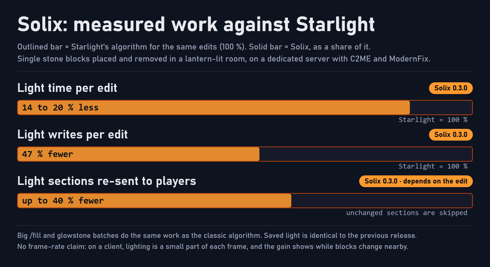

<p align="center">
  
</p>

# Solix

Solix is a light engine for Minecraft 1.20.1 on Forge. It is built on [Starlight](https://github.com/PaperMC/Starlight)'s rewrite of the vanilla light engine and ScalableLux's parallel scheduler, and it **does less work in the first place**: same lighting as vanilla, with fewer blocks touched, fewer light packets sent and fewer chunk re-renders on the client.

> **Works on the client, the server, or both.** Vanilla clients can join a Solix server and the other way round, and worlds stay compatible with Starlight 1.1.2 in both directions (same saved light format). Solix replaces Starlight, ScalableLux and Lucis: do not install them alongside it.

## Features

### Less work per light update

- **Targeted darkness.** When you place a block in a lit room, Starlight darkens the whole area behind it and lights it again from scratch, although nearly every block there is still lit from another direction. Solix checks first and darkens only the blocks that really lost their light. Where a light source itself is removed, nearly everything around it loses its light, so Solix keeps Starlight's full darkening there.
- **Brightest-first spreading.** Light spreads from level 15 downward, so every block is lit once, at its final level, instead of first by a dim source and then again by a brighter one.
- **No extra memory.** Where a block's light came from is worked out from the light values themselves. Nothing is added to the save format.

### Less traffic and fewer re-renders

- **Unchanged light is not sent again.** If a section's light ends up byte-identical after an update, the server skips its light packet, and clients skip re-meshing that section and its neighbours. This helps client frame rate while other players build nearby.

### Threads and priority

- **Parallel server lighting** on worker threads, with ScalableLux's scheduler and FlowSched's executor. The default worker count is chosen from the CPU, and serial lighting remains available.
- **Nearest chunks first.** With more than one worker, light work is ordered by each chunk's distance to players, so the area around you is ready sooner while exploring or generating terrain.
- **Safe fallback.** If the worker threads cannot be started, Solix switches to serial lighting by itself.

### Correct on Forge

- **A working opacity cache.** The Forge port of Starlight built a fast lookup for how much light each block stops and then threw it away, so every light step took the slow path. Solix keeps it, and still falls back to the slow path for blocks that need it: dynamic shapes and modded blocks whose light depends on position.
- **Faster light-source scanning and section bookkeeping.** New chunks skip sections that cannot hold a light source, and the question of which light sections must exist uses bitmasks.
- **Other mods' light callbacks cannot stall the server.** Block code that asks for light data from a light worker gets a view that never waits on the server thread, so a mod that reads its own block entity there cannot deadlock a world load.
- **Failures are contained.** A chunk's light ticket is released even when lighting that chunk throws, and queued work from a failed update is cleared.

### Compatibility and safety

- **Same lighting.** Every release is checked by relighting a test world, applying block edits and comparing the saved light block by block with the previous release. One config line, `propagation = classic`, switches back to Starlight's original algorithm.
- **Checked against the RatPack 2.9 mod list** (about 450 mods, including C2ME, ModernFix, Radium, Embeddium and Xenon, Oculus, NeoVoxy, Flywheel and Create, Mekanism and AE2), and run on a dedicated server with C2ME and ModernFix.
- **Old worlds are safe.** Worlds lit by vanilla are relit automatically the first time their chunks load.

## Performance

Solix is a CPU-side mod and has no GPU cost. It measures its work in light time, light writes and packets, not in frame rate: **on a client, lighting is a small part of each frame**, so no frame-rate claim is made. The gain shows while blocks change around you (building, redstone, explosions, other players working nearby), and servers benefit more.

<p align="center">
  
</p>

The figures below are the project's own measurements: single stone blocks placed and removed in a lantern-lit room, on a dedicated server with C2ME and ModernFix, against Starlight's algorithm on the same edits.

| Metric | Result |
|---|---|
| **Frame rate** | No claim. Fewer light packets mean fewer client re-renders, up to about 40 % of updated sections depending on the edit |
| **Light time** | 14 to 20 % less than Starlight's algorithm per single-block edit |
| **Light writes** | 47 % fewer per single-block edit. Big `/fill` batches and glowstone add and remove batches do the same work as the classic algorithm (the ordered mode writes 6 to 9 % fewer) |
| **Sync** | Light work runs on worker threads, and other mods' light callbacks never wait on the server thread |
| **Overhead** | No extra memory per block and no save-format change. The bookkeeping that took 5 to 10 % of light worker time in profiles is no longer visible since 0.3.1 |

For benchmarking, `-Dsolix.debug.lightStats=true` logs light engine counters every 10 seconds.

## Roadmap

| Release | Theme | Content |
|---|---|---|
| 0.1.x | Port | Starlight 1.1.2 for Forge with its later fixes, the working opacity cache, rebrand |
| 0.2.x | Parallel | ScalableLux's scheduler, FlowSched, light work ordered by distance |
| 0.3.x | Less work (**current: 0.3.7**) | Targeted darkness, brightest-first queues, unchanged sections not re-sent, bitmask bookkeeping, the safe light view, failure containment |

Solix has no feature roadmap beyond this. It changes only what a measurement justifies, and the changelog records what was evaluated and not adopted, with the reasons: the Vector API and FFM, per-block pointers to the brightest neighbour, spreading darkness over several ticks, SWAR-packed light arithmetic and delaying light packets. Rendering techniques belong to the renderer and shader mods, not the light engine.

## Requirements

- Minecraft **1.20.1** with Forge **47.x**
- Java **17** or newer
- Not compatible with Starlight, ScalableLux or Lucis. Forge tells you if more than one is installed.

## Installation

1. Remove Starlight, ScalableLux and Lucis if you have them.
2. Place `solix-<version>-mc1.20.1-forge.jar` in `mods`, on the server, the client, or both.
3. Options are in `config/solix.toml`, and a restart applies them:

```toml
parallel = true          # multithreaded server lighting
parallelism = 0          # worker threads, 0 = automatic
throttle_ms = 10         # stops C2ME's light thread from busy-waiting
propagation = targeted   # targeted | ordered | classic (Starlight's original)
safe_light_view = true   # give other mods' light callbacks a view that never waits on the server thread
```

## Building

```bash
./gradlew build
```

It needs a JDK 17 and writes `build/libs/solix-<version>-mc1.20.1-forge.jar`.

## Licence and attribution

- Solix is licensed under the **GNU Lesser General Public License v3.0 only** ([`LICENSE`](LICENSE)). Copyright (C) Spottedleaf, RelativityMC (ScalableLux) and SolarBiscuit.
- Solix is a modified version of, and contains code from, [Starlight](https://github.com/PaperMC/Starlight) (Forge branch, Starlight Forge 1.1.2 plus later fixes) by Spottedleaf, and [ScalableLux](https://github.com/RelativityMC/ScalableLux) by RelativityMC and ishland, both LGPL-3.0-only. The Java packages `ca.spottedleaf.starlight.*` are kept unchanged for compatibility with mods that reflect on them.
- The task executor is [FlowSched](https://github.com/RelativityMC/FlowSched) by RelativityMC and ishland, vendored under the MIT licence ([`LICENSE-FlowSched.txt`](LICENSE-FlowSched.txt)).
- [`NOTICE`](NOTICE) lists the sources, and [`CHANGELOG.txt`](CHANGELOG.txt) lists the changes made for Solix. [`TECHNICAL_DETAILS.md`](TECHNICAL_DETAILS.md) is Starlight's own write-up of the light engine, kept from upstream.
- Solix is an independent project. It is not affiliated with, endorsed by, or supported by Spottedleaf, PaperMC, RelativityMC, Mojang Studios, Microsoft or Minecraft Forge.

## Reporting issues

Issues belong in the [Solix issue tracker](https://github.com/SolarBiscuit/Solix/issues). Please include the Solix version, the mods you run, `latest.log`, and whether `propagation = classic` makes the problem go away.
